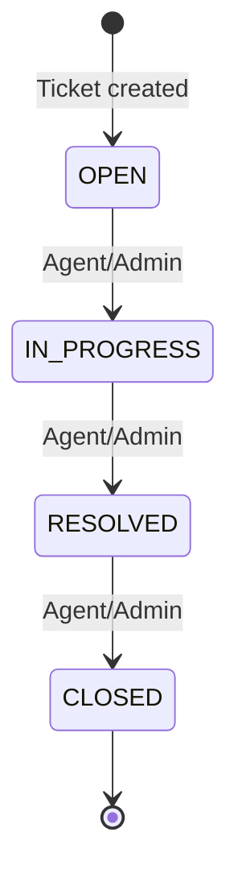
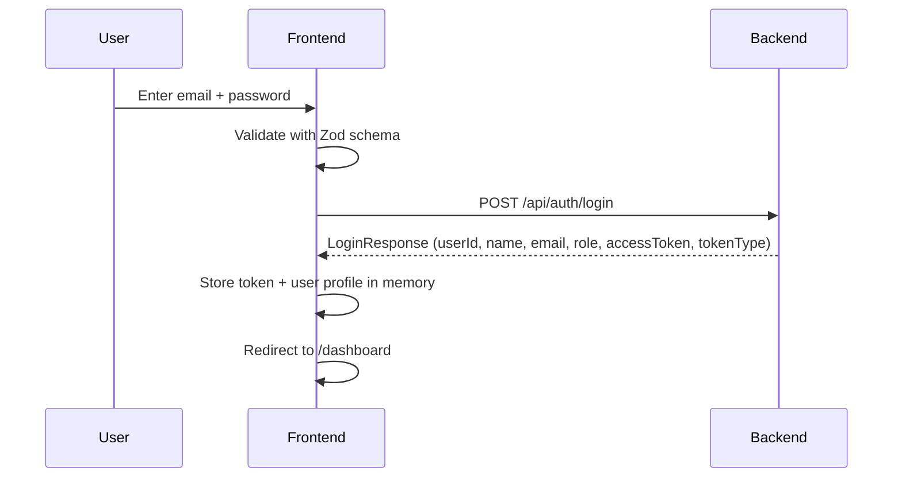

# AI Support Platform — Frontend Plan

> **Status:** AWAITING APPROVAL — no files have been created, modified, or deleted.

---

## 1. Backend Understanding

### 1.1 Files Inspected

I read every Java source file (51 files) across all packages, plus `application.properties`, all 6 Flyway migrations, and `build.gradle.kts`. The backend is a stateless REST API built on Spring Boot 4.1.1 / Java 25.

### 1.2 Complete API Endpoint Inventory

| Method | Path | Controller | Auth | Notes |
|--------|------|-----------|------|-------|
| `POST` | `/api/auth/register` | [AuthController](file:///c:/study/ai-support-platform/src/main/java/com/supportai/auth/controller/AuthController.java) | Public | Creates CUSTOMER. Returns `AuthResponse` (no token). |
| `POST` | `/api/auth/login` | [AuthController](file:///c:/study/ai-support-platform/src/main/java/com/supportai/auth/controller/AuthController.java) | Public | Returns `LoginResponse` with JWT `accessToken`. |
| `POST` | `/api/auth/change-password` | [AuthController](file:///c:/study/ai-support-platform/src/main/java/com/supportai/auth/controller/AuthController.java) | Authenticated | 204 No Content on success. |
| `POST` | `/api/tickets` | [TicketController](file:///c:/study/ai-support-platform/src/main/java/com/supportai/ticket/controller/TicketController.java) | Authenticated | Creates ticket. AI auto-classifies if `category` is null. |
| `GET` | `/api/tickets` | [TicketController](file:///c:/study/ai-support-platform/src/main/java/com/supportai/ticket/controller/TicketController.java) | Authenticated | Paginated + filtered. Role-scoped visibility. |
| `GET` | `/api/tickets/{id}` | [TicketController](file:///c:/study/ai-support-platform/src/main/java/com/supportai/ticket/controller/TicketController.java) | Authenticated | Role-scoped access check. |
| `PUT` | `/api/tickets/{id}` | [TicketController](file:///c:/study/ai-support-platform/src/main/java/com/supportai/ticket/controller/TicketController.java) | Authenticated | Full update. Customers cannot change status. |
| `DELETE` | `/api/tickets/{id}` | [TicketController](file:///c:/study/ai-support-platform/src/main/java/com/supportai/ticket/controller/TicketController.java) | Authenticated | Customers cannot delete. Agents/admins can. |
| `PATCH` | `/api/tickets/{id}/assign` | [TicketController](file:///c:/study/ai-support-platform/src/main/java/com/supportai/ticket/controller/TicketController.java) | ADMIN only | Assigns ticket to an AGENT user. |
| `POST` | `/api/tickets/{ticketId}/comments` | [TicketCommentController](file:///c:/study/ai-support-platform/src/main/java/com/supportai/ticket/comment/controller/TicketCommentController.java) | Authenticated | Role-scoped access to parent ticket. |
| `GET` | `/api/tickets/{ticketId}/comments` | [TicketCommentController](file:///c:/study/ai-support-platform/src/main/java/com/supportai/ticket/comment/controller/TicketCommentController.java) | Authenticated | Chronological order. Role-scoped. |
| `GET` | `/api/tickets/{ticketId}/audit-logs` | [TicketAuditLogController](file:///c:/study/ai-support-platform/src/main/java/com/supportai/audit/controller/TicketAuditLogController.java) | Authenticated | Role-scoped access. Chronological. |
| `GET` | `/api/notifications` | [NotificationController](file:///c:/study/ai-support-platform/src/main/java/com/supportai/notification/controller/NotificationController.java) | Authenticated | Paginated. Optional `unreadOnly` filter. |
| `GET` | `/api/notifications/unread-count` | [NotificationController](file:///c:/study/ai-support-platform/src/main/java/com/supportai/notification/controller/NotificationController.java) | Authenticated | Returns `{ "unreadCount": N }`. |
| `PATCH` | `/api/notifications/{id}/read` | [NotificationController](file:///c:/study/ai-support-platform/src/main/java/com/supportai/notification/controller/NotificationController.java) | Authenticated | 204 No Content. Owner-only. |
| `GET` | `/api/health` | [HealthController](file:///c:/study/ai-support-platform/src/main/java/com/supportai/health/HealthController.java) | Public | `{ "status": "UP" }` |
| `GET` | `/actuator/health` | Spring Actuator | Public | Standard actuator health. |

### 1.3 Authentication & JWT Behavior

- **Algorithm:** HS256 (HMAC-SHA256), secret loaded from `${JWT_SECRET}` env var (Base64-encoded).
- **Token lifetime:** 900,000 ms = **15 minutes**.
- **JWT subject:** User's database `id` (numeric string).
- **JWT claims:** `sub` (user ID), `email`, `role` (CUSTOMER/AGENT/ADMIN), `iss` ("ai-support-platform"), `iat`, `exp`.
- **Validation:** Issuer, expiry, role claim (must be a valid `Role` enum value), subject (must be a positive integer).
- **Session management:** Stateless. No refresh tokens. No cookies. CSRF disabled.
- **Token delivery:** Login response returns `accessToken` + `tokenType: "Bearer"` in the JSON body.
- **There is no refresh token endpoint.** After 15 minutes the token expires and the user must re-authenticate.
- **There is no logout endpoint.** Tokens are stateless; "logout" is a client-side concern.

### 1.4 Roles & Permissions

| Capability | CUSTOMER | AGENT | ADMIN |
|---|---|---|---|
| Register (public) | ✅ (always CUSTOMER) | ❌ | ❌ |
| Create ticket | ✅ | ✅ | ✅ |
| View own tickets | ✅ | — | — |
| View assigned tickets | — | ✅ | — |
| View all tickets | — | — | ✅ |
| Filter by `assignedAgentId` | ❌ | ❌ | ✅ |
| Update ticket fields | ✅ (own, no status change) | ✅ (assigned) | ✅ (any) |
| Change ticket status | ❌ | ✅ | ✅ |
| Delete ticket | ❌ | ✅ (assigned) | ✅ (any) |
| Assign ticket to agent | ❌ | ❌ | ✅ |
| Add/read comments | ✅ (own ticket) | ✅ (assigned) | ✅ (any) |
| View audit logs | ✅ (own ticket) | ✅ (assigned) | ✅ (any) |
| Notifications | ✅ (own) | ✅ (own) | ✅ (own) |
| Change password | ✅ | ✅ | ✅ |

> [!IMPORTANT]
> There is no API to register AGENT or ADMIN users. Agent/Admin accounts must be created directly in the database or via a future admin endpoint. Registration always creates CUSTOMER.

### 1.5 Ticket Status State Machine



Only forward transitions are allowed. `CLOSED` is terminal.

### 1.6 Enums

**TicketCategory:** `ACCOUNT_ACCESS`, `PAYMENT`, `TECHNICAL_ISSUE`, `BUG_REPORT`, `FEATURE_REQUEST`, `GENERAL_QUERY`

**TicketPriority:** `LOW`, `MEDIUM`, `HIGH`, `URGENT`

**Status (string, not enum):** `OPEN`, `IN_PROGRESS`, `RESOLVED`, `CLOSED`

### 1.7 Filtering, Sorting & Pagination (GET `/api/tickets`)

| Param | Type | Default | Notes |
|---|---|---|---|
| `page` | int | `0` | 0-indexed. Must be ≥ 0. |
| `size` | int | `10` | 1–100. |
| `sortBy` | string | `createdAt` | Allowed: `id`, `title`, `status`, `priority`, `category`, `createdAt`, `updatedAt` |
| `direction` | string | `desc` | `asc` or `desc`. |
| `status` | string | — | Case-insensitive filter. |
| `search` | string | — | LIKE match on `title` and `description`. |
| `priority` | TicketPriority | — | Exact enum match. |
| `category` | TicketCategory | — | Exact enum match. |
| `assignedAgentId` | Long | — | ADMIN only. |

**PageResponse shape:** `{ content: T[], page, size, totalElements, totalPages, first, last }`

### 1.8 Notification Types

Generated automatically by the backend: `TICKET_UPDATED`, `TICKET_ASSIGNED`, `NEW_COMMENT`.

### 1.9 AI Classification

- **Hybrid strategy:** Rule-based first → Ollama (`qwen3:4b`) fallback.
- **Transparent to the frontend:** The frontend simply omits the `category` field (or sends `null`) when creating/updating a ticket, and the backend fills it automatically.
- Category is returned in the `TicketResponse`.

### 1.10 Error Response Formats

The [GlobalExceptionHandler](file:///c:/study/ai-support-platform/src/main/java/com/supportai/exception/GlobalExceptionHandler.java) produces these shapes:

**Validation errors (400):**
```json
{ "timestamp": "...", "status": 400, "error": "Validation Failed", "errors": { "field": "message" } }
```

**Business rule errors (400):**
```json
{ "timestamp": "...", "status": 400, "error": "Bad Request", "message": "..." }
```

**Forbidden (403):**
```json
{ "timestamp": "...", "status": 403, "error": "Forbidden", "message": "..." }
```

**Not found (404):**
```json
{ "timestamp": "...", "status": 404, "error": "Not Found", "message": "..." }
```

**401 Unauthorized:** Handled by Spring Security's OAuth2 resource server (standard Spring response, not custom).

### 1.11 CORS Configuration

> [!WARNING]
> **No CORS configuration exists.** There are no `@CrossOrigin` annotations, no `CorsConfiguration` beans, and no `WebMvcConfigurer` implementing `addCorsMappings`. A frontend running on a different origin (e.g., `http://localhost:5173`) **will be blocked by the browser's same-origin policy**. CORS configuration must be added to the backend before the frontend can communicate with it.
>
> This is the single most critical prerequisite. It requires a small backend change.

### 1.12 What the Backend Does NOT Support

These capabilities do **not** exist and would require **FUTURE BACKEND WORK**:

| Missing Capability | Impact |
|---|---|
| CORS configuration | **Blocker** — frontend cannot communicate |
| Refresh tokens | 15-min session limit; no silent renewal |
| Get current user profile (`GET /api/users/me`) | Cannot populate settings/profile page |
| Update user profile (name, email) | No profile editing |
| List agents (`GET /api/users?role=AGENT`) | Admin cannot populate the agent dropdown for assignment |
| Dashboard statistics (ticket counts by status, priority, etc.) | No backend aggregation endpoints |
| Mark all notifications as read | Only single-notification mark-as-read exists |
| Forgot password / password reset | No reset token flow |
| OAuth2 / social login | No Google/Microsoft integration |
| File/image uploads | No attachment support |
| User avatar/profile image | No image storage |
| Delete notification | No endpoint |
| Global audit log listing (all tickets) | Audit logs are per-ticket only |

---

## 2. Design Review

### 2.1 Visual Ideas Worth Retaining

Based on your stated preferences:

| Element | Recommendation |
|---|---|
| **Light, clean interface** | ✅ Use a neutral `slate-50`/`slate-100` background. Avoid pure white — a slight warm gray provides depth. |
| **Pale blue-grey backgrounds** | ✅ Exactly right for a professional SaaS tool. |
| **Indigo/violet accents** | ✅ Use indigo-600 as the primary action color with violet-500 for secondary highlights. Limit accent usage to CTAs, badges, and active states. |
| **Subtle neumorphism** | ✅ Apply only to cards and input fields with `shadow-sm` and a very light `ring-1 ring-slate-200`. Avoid heavy inset shadows. |
| **Rounded cards and inputs** | ✅ Use `rounded-lg` (8px) for cards, `rounded-md` (6px) for inputs and buttons. Avoid fully round (`rounded-full`) on anything except avatar placeholders. |
| **Clear typography and spacing** | ✅ Use Inter font. Establish a consistent type scale. Generous padding in cards. |
| **Polished SaaS appearance** | ✅ Consistent color tokens, deliberate whitespace, professional data tables. |

### 2.2 Design Issues to Correct

| Concern | Correction |
|---|---|
| **Excessive card shadows** | Keep shadows to one level (`shadow-sm`). No layered shadow effects. |
| **Low-contrast text** | All text must pass WCAG AA contrast (4.5:1 for body, 3:1 for large text). Gray-on-gray labels are common in neumorphic designs — avoid them. |
| **Decorative gradients** | Use flat or single-color backgrounds. No gratuitous gradient cards or headers. |
| **Fake statistics** | Do not show "Total Tickets: 1,247" or "Avg Resolution: 2.4h" — no backend endpoint provides aggregated stats. Show only what the API returns. |
| **Dead buttons** | Every button must be wired to a real action. If a feature isn't supported, don't render the button. |
| **Overly rounded cards** | `rounded-xl` and larger can look toy-like at scale. Stick to `rounded-lg`. |
| **Responsive breakpoints** | Reference images appear desktop-only. The implementation must include mobile and tablet layouts. |

---

## 3. Recommended Frontend Stack

### 3.1 Core Stack

| Library | Version | Purpose |
|---|---|---|
| **React** | 19.x | UI framework |
| **TypeScript** | 5.x | Type safety (strict mode) |
| **Vite** | 6.x | Build tool and dev server |
| **React Router** | 7.x | Client-side routing |
| **TanStack Query (React Query)** | 5.x | Server state management, caching, request deduplication |
| **React Hook Form** | 7.x | Performant form state management |
| **Zod** | 3.x | Schema validation — shared between forms and API responses |
| **Axios** | 1.x | HTTP client with interceptors for JWT and error handling |

### 3.2 UI Library Decision: Tailwind CSS + shadcn/ui

**Recommendation: Tailwind CSS v4 + shadcn/ui**

**Why this combination wins for your project:**

1. **shadcn/ui is not a dependency** — it copies component source code into your project. You own every line, can customize freely, and there are no version-lock risks. This is perfect for a portfolio project where you want to demonstrate your own component code.

2. **Accessibility built in** — shadcn/ui components are built on Radix UI primitives, which handle keyboard navigation, focus management, ARIA attributes, and screen reader support correctly.

3. **Your design language** — Tailwind's utility-first approach plus shadcn's CSS custom properties make it trivial to implement your specific color palette (indigo/violet accents, slate backgrounds) with a single theme configuration.

4. **Industry credibility** — Tailwind + shadcn/ui is the most widely adopted modern frontend stack. Recruiters and hiring managers will recognize it instantly.

**Why not Mantine:**
- Mantine is excellent but opinionated about its design language. Achieving subtle neumorphism and your specific palette requires fighting its defaults. It also adds a heavier runtime dependency.

**Why not Material UI:**
- Google's Material Design aesthetic (paper elevation, ripple effects) conflicts with your stated preference for subtle neumorphism and indigo/violet accents.

### 3.3 Additional Utilities

| Library | Purpose |
|---|---|
| `date-fns` | Lightweight date formatting (relative times, locale-aware) |
| `sonner` | Toast notifications (integrates with shadcn/ui) |
| `lucide-react` | Icon set (shadcn/ui's default icon library) |
| `clsx` + `tailwind-merge` | Conditional class merging (already included by shadcn/ui's `cn` utility) |

### 3.4 Libraries NOT Included (and Why)

| Omitted | Reason |
|---|---|
| Redux / Zustand | TanStack Query handles server state; auth state is small enough for React Context. Avoid premature global state. |
| Storybook | Great for large teams; overkill for a solo developer in Phase 1. Can be added later. |
| i18n | Not requested; adds complexity. Easy to retrofit if needed. |
| WebSockets | No backend WebSocket support. Notifications use polling. |

---

## 4. Complete Page Inventory

### 4.1 Routing Architecture

I recommend a **single layout system with role-based content switching** rather than completely separate `/customer/*`, `/agent/*`, `/admin/*` route trees. The reason:

- Agents and admins share most UI components (ticket tables, comment views, notification panels).
- Shared layouts reduce code duplication.
- Role checks happen at the component level, backed by real backend authorization.

The main layout includes a sidebar (desktop) / bottom nav (mobile) that adapts its menu items based on the authenticated user's role.

### 4.2 Page Inventory

---

#### Page: Login
| Attribute | Value |
|---|---|
| **Route** | `/login` |
| **Roles** | Public (redirect authenticated users to dashboard) |
| **Components** | `LoginForm`, `AuthLayout` |
| **API** | `POST /api/auth/login` |
| **States** | Loading (submit button), validation errors (email format, required fields), API error ("Invalid email or password"), success (redirect) |
| **Backend support** | ✅ Fully supported |

---

#### Page: Sign Up
| Attribute | Value |
|---|---|
| **Route** | `/register` |
| **Roles** | Public |
| **Components** | `RegisterForm`, `AuthLayout` |
| **API** | `POST /api/auth/register` |
| **States** | Loading, field validation (name ≤100, email format, password 8–100), API error ("Email is already registered"), success (redirect to login) |
| **Backend support** | ✅ Fully supported. Note: registration always creates CUSTOMER. |

---

#### Page: Dashboard
| Attribute | Value |
|---|---|
| **Route** | `/dashboard` |
| **Roles** | CUSTOMER, AGENT, ADMIN |
| **Components** | `DashboardLayout`, `TicketSummaryCards` (derived from ticket list), `RecentTicketsTable`, `QuickActions` |
| **API** | `GET /api/tickets` (with role-scoped defaults), `GET /api/notifications/unread-count` |
| **States** | Loading (skeleton), empty ("No tickets yet" + create CTA for customers), error (retry) |
| **Backend support** | ⚠️ Partially supported. There are **no aggregation endpoints** for statistics (total by status, average resolution time, etc.). Dashboard cards can be derived by fetching the first page of tickets with different status filters, but this is limited. Counters like "Open: 5, In Progress: 3" can be derived from `totalElements` of filtered queries, but this requires multiple API calls and won't scale well. |

**Dashboard content by role:**
- **CUSTOMER:** "My Recent Tickets" table, "Submit New Ticket" CTA, unread notification count.
- **AGENT:** "My Assigned Tickets" table, tickets filtered by status, unread notification count.
- **ADMIN:** "All Tickets" table, ticket assignment CTA, unread notification count.

> [!IMPORTANT]
> **FUTURE BACKEND WORK:** Dedicated `GET /api/tickets/stats` or `GET /api/dashboard` endpoint returning ticket counts grouped by status, priority, and category. Without this, the dashboard will show a recent tickets list rather than aggregate metrics.

---

#### Page: Tickets List (My Tickets / Assigned Tickets / All Tickets)
| Attribute | Value |
|---|---|
| **Route** | `/tickets` |
| **Roles** | CUSTOMER (own), AGENT (assigned), ADMIN (all) |
| **Components** | `TicketFilters` (status, priority, category, search), `TicketTable` with pagination, `StatusBadge`, `PriorityBadge`, `CategoryBadge` |
| **API** | `GET /api/tickets?page=&size=&sortBy=&direction=&status=&priority=&category=&search=&assignedAgentId=` |
| **States** | Loading (skeleton rows), empty ("No tickets found" + optional CTA), error (retry), filter active indicator |
| **Backend support** | ✅ Fully supported. Full pagination, filtering, sorting, and search. |

---

#### Page: Create Ticket
| Attribute | Value |
|---|---|
| **Route** | `/tickets/new` |
| **Roles** | CUSTOMER, AGENT, ADMIN |
| **Components** | `TicketForm`, `CategorySelect` (optional — leave empty for AI classification), `PrioritySelect` |
| **API** | `POST /api/tickets` |
| **Validation** | Title: required, max 255 chars. Description: required. Priority: required (LOW/MEDIUM/HIGH/URGENT). Category: optional. |
| **States** | Loading (submit), validation errors (field-level), API error, success (redirect to ticket detail) |
| **Backend support** | ✅ Fully supported. AI auto-classification is triggered when category is null. |

---

#### Page: Ticket Detail
| Attribute | Value |
|---|---|
| **Route** | `/tickets/:id` |
| **Roles** | CUSTOMER (own), AGENT (assigned), ADMIN (any) |
| **Components** | `TicketHeader` (title, status badge, priority, category, dates), `TicketDescription`, `CommentTimeline`, `CommentForm`, `AuditLogTimeline`, `TicketActions` (edit, status change, assign, delete) |
| **API** | `GET /api/tickets/{id}`, `GET /api/tickets/{id}/comments`, `POST /api/tickets/{id}/comments`, `GET /api/tickets/{id}/audit-logs`, `PUT /api/tickets/{id}`, `DELETE /api/tickets/{id}`, `PATCH /api/tickets/{id}/assign` |
| **States** | Loading (skeleton), 404 (ticket not found), 403 (access denied), comment loading, audit log loading |
| **Backend support** | ✅ Fully supported. |

**Role-specific actions on this page:**
- **CUSTOMER:** Edit title/description/priority/category, add comment. Cannot change status or delete.
- **AGENT:** Edit fields, change status (according to state machine), add comment, delete.
- **ADMIN:** All agent actions + assign to agent.

> [!WARNING]
> **FUTURE BACKEND WORK (Assign dropdown):** The admin "Assign to Agent" action requires listing available agents. There is no `GET /api/users?role=AGENT` endpoint. **The admin will need to type the agent's user ID manually, or a list-agents endpoint must be added first.** I recommend labeling this as Phase 2 backend work.

---

#### Page: Notifications
| Attribute | Value |
|---|---|
| **Route** | `/notifications` |
| **Roles** | CUSTOMER, AGENT, ADMIN |
| **Components** | `NotificationList`, `NotificationItem` (with unread indicator), `UnreadFilter` toggle |
| **API** | `GET /api/notifications?page=&size=&unreadOnly=`, `PATCH /api/notifications/{id}/read`, `GET /api/notifications/unread-count` |
| **States** | Loading (skeleton), empty ("No notifications" — quiet state), error (retry), individual mark-as-read loading |
| **Backend support** | ✅ Fully supported for listing, filtering, and marking individual as read. |

> [!NOTE]
> **FUTURE BACKEND WORK:** No "Mark All as Read" endpoint exists. The frontend could loop through and mark each individually, but this is fragile. Recommend adding `PATCH /api/notifications/mark-all-read` later.

---

#### Page: Account Settings / Change Password
| Attribute | Value |
|---|---|
| **Route** | `/settings` |
| **Roles** | CUSTOMER, AGENT, ADMIN |
| **Components** | `SettingsLayout`, `ProfileInfo` (read-only display of name, email, role from login data), `ChangePasswordForm` |
| **API** | `POST /api/auth/change-password` |
| **Validation** | Current password: required. New password: required, 8–72 chars, must differ from current. |
| **States** | Loading, validation errors, "Current password is incorrect" error, "New password must be different" error, success toast |
| **Backend support** | ⚠️ Partially supported. Password change works. Profile display relies on cached login response data (name, email, role). |

> [!IMPORTANT]
> **FUTURE BACKEND WORK:** No `GET /api/users/me` or `PUT /api/users/me` endpoints. Profile info is read-only and sourced from the login response or decoded JWT claims. Name/email editing is not possible without backend changes.

---

#### Page: Access Denied (403)
| Attribute | Value |
|---|---|
| **Route** | `/403` (or rendered inline by route guard) |
| **Roles** | Any |
| **Components** | `ErrorPage` with role-appropriate message |
| **API** | None |
| **Backend support** | ✅ Frontend-only. |

---

#### Page: Not Found (404)
| Attribute | Value |
|---|---|
| **Route** | `*` (catch-all) |
| **Roles** | Any |
| **Components** | `ErrorPage` with navigation back |
| **API** | None |
| **Backend support** | ✅ Frontend-only. |

---

### 4.3 Pages NOT Recommended

| Rejected Page | Reason |
|---|---|
| Separate Admin Dashboard page | Use a single `/dashboard` with role-aware content. Less duplication. |
| Separate Agent Dashboard page | Same — shared dashboard layout. |
| Admin User Management | No user listing, creation, or role-change APIs exist. |
| Forgot Password | No password reset token flow exists in the backend. |
| User Profile Edit (name/email) | No profile update endpoint. |

---

## 5. Authentication & Authorization Integration

### 5.1 Login Flow



### 5.2 Token Storage Strategy

**Recommendation: In-memory storage (React Context/state) with `localStorage` persistence.**

| Approach | Tradeoff |
|---|---|
| **In-memory only** | Most secure against XSS. Token lost on page refresh — user must re-login. |
| **`localStorage`** | Survives refresh. Vulnerable to XSS. |
| **`httpOnly` cookie** | Most secure, but requires backend changes (Set-Cookie headers, CSRF protection). |

**Practical recommendation for this project:** Store the token in `localStorage` and load it into an in-memory auth context on app startup. This is the standard pattern for SPAs with stateless JWT backends.

> [!WARNING]
> `localStorage` is accessible to any JavaScript running on the same origin. If the application has an XSS vulnerability, the token can be stolen. This is a known limitation of stateless JWT authentication in SPAs. The backend does not set `httpOnly` cookies, so this is the only option without backend changes. **The frontend is not the security boundary** — backend authorization is always enforced server-side.

### 5.3 Token Lifecycle

1. **On login:** Store `{ accessToken, userId, name, email, role }` in an `AuthContext`.
2. **On every API request:** Axios request interceptor attaches `Authorization: Bearer <token>`.
3. **On 401 response:** Axios response interceptor clears auth state and redirects to `/login` with a "Session expired" message.
4. **On 403 response:** Show an inline error or redirect to `/403`. Do NOT clear auth state (the user is authenticated but unauthorized for this action).
5. **On page refresh:** Read token from `localStorage`, decode the JWT (client-side, without verification) to check `exp`. If expired, clear and redirect to login. If valid, restore auth context.
6. **On "logout":** Clear `localStorage` and auth context, redirect to `/login`.

> [!NOTE]
> **The 15-minute token lifetime is short.** Users will experience frequent session expirations. Consider this a **FUTURE BACKEND WORK** item: add a refresh token endpoint (`POST /api/auth/refresh`) that issues new access tokens without requiring re-login.

### 5.4 Protected Routes

```tsx
// Pseudocode — not implementation
<Route element={<RequireAuth />}>              {/* Must be authenticated */}
  <Route element={<AppLayout />}>
    <Route path="/dashboard" element={<Dashboard />} />
    <Route path="/tickets" element={<TicketList />} />
    <Route path="/tickets/new" element={<CreateTicket />} />
    <Route path="/tickets/:id" element={<TicketDetail />} />
    <Route path="/notifications" element={<Notifications />} />
    <Route path="/settings" element={<Settings />} />
  </Route>
</Route>
```

Role checks are **advisory in the frontend** (hide UI elements the user can't use) and **enforced by the backend** (403 responses).

### 5.5 Role-Based Navigation

The sidebar/nav renders different items per role:

| Nav Item | CUSTOMER | AGENT | ADMIN |
|---|---|---|---|
| Dashboard | ✅ | ✅ | ✅ |
| My Tickets / Assigned Tickets / All Tickets | ✅ | ✅ | ✅ |
| Submit Ticket | ✅ | ✅ | ✅ |
| Notifications | ✅ | ✅ | ✅ |
| Settings | ✅ | ✅ | ✅ |

### 5.6 Form Validation Integration

**Frontend (Zod + React Hook Form):**
- Validate before submission (email format, required fields, password length).
- Provides instant feedback.

**Backend validation error mapping:**
- When the backend returns `{ "errors": { "title": "Title is required" } }`, the Axios error interceptor maps these to React Hook Form's `setError("title", { message: "Title is required" })`.
- When the backend returns `{ "message": "Email is already registered" }`, display as a form-level error above the submit button.

---

## 6. Proposed Folder Structure

```
frontend/
├── index.html
├── package.json
├── tsconfig.json
├── vite.config.ts
├── tailwind.config.ts         # Tailwind v4 config (if needed; v4 uses CSS config)
├── components.json            # shadcn/ui configuration
├── .env.example               # VITE_API_BASE_URL=http://localhost:8080
│
├── public/
│   └── favicon.ico
│
└── src/
    ├── main.tsx                # React entry point
    ├── App.tsx                 # Router + providers
    ├── index.css               # Tailwind directives + design tokens (CSS variables)
    │
    ├── api/                    # API client layer
    │   ├── client.ts           # Axios instance with interceptors
    │   ├── auth.ts             # Auth API functions (login, register, changePassword)
    │   ├── tickets.ts          # Ticket API functions (CRUD, assign)
    │   ├── comments.ts         # Comment API functions
    │   ├── notifications.ts    # Notification API functions
    │   └── audit-logs.ts       # Audit log API functions
    │
    ├── types/                  # Shared TypeScript types
    │   ├── auth.ts             # LoginRequest, LoginResponse, RegisterRequest, etc.
    │   ├── ticket.ts           # Ticket, CreateTicketRequest, UpdateTicketRequest, PageResponse, enums
    │   ├── comment.ts          # CommentResponse, CreateCommentRequest
    │   ├── notification.ts     # NotificationResponse
    │   ├── audit-log.ts        # AuditLogResponse
    │   └── api.ts              # ApiError, ValidationError, PaginationParams
    │
    ├── schemas/                # Zod validation schemas
    │   ├── auth.schemas.ts     # Login, register, change-password schemas
    │   └── ticket.schemas.ts   # Create/update ticket schemas, comment schema
    │
    ├── hooks/                  # Custom React hooks
    │   ├── use-auth.ts         # useAuth() — returns user, login, logout, isAuthenticated
    │   ├── use-tickets.ts      # useTickets(), useTicket(id), useCreateTicket(), etc.
    │   ├── use-comments.ts     # useComments(ticketId), useAddComment()
    │   ├── use-notifications.ts # useNotifications(), useUnreadCount(), useMarkAsRead()
    │   └── use-audit-logs.ts   # useAuditLogs(ticketId)
    │
    ├── context/                # React Context providers
    │   └── auth-context.tsx    # AuthProvider + useAuthContext
    │
    ├── components/             # Shared/reusable components
    │   ├── ui/                 # shadcn/ui primitives (Button, Input, Card, Dialog, etc.)
    │   ├── layout/
    │   │   ├── AppLayout.tsx   # Sidebar + header + main content area
    │   │   ├── AuthLayout.tsx  # Centered card layout for login/register
    │   │   ├── Sidebar.tsx     # Role-aware navigation sidebar
    │   │   └── Header.tsx      # Top bar with user info + notification bell
    │   ├── StatusBadge.tsx
    │   ├── PriorityBadge.tsx
    │   ├── CategoryBadge.tsx
    │   ├── DataTable.tsx       # Reusable table with sorting headers
    │   ├── Pagination.tsx      # Page controls bound to PageResponse
    │   ├── EmptyState.tsx      # "No items" placeholder with optional CTA
    │   ├── ErrorBoundary.tsx   # React error boundary
    │   ├── LoadingSkeleton.tsx  # Skeleton loader variants
    │   └── ConfirmDialog.tsx   # Destructive action confirmation
    │
    ├── pages/                  # Route-level page components
    │   ├── LoginPage.tsx
    │   ├── RegisterPage.tsx
    │   ├── DashboardPage.tsx
    │   ├── TicketListPage.tsx
    │   ├── CreateTicketPage.tsx
    │   ├── TicketDetailPage.tsx
    │   ├── NotificationsPage.tsx
    │   ├── SettingsPage.tsx
    │   ├── NotFoundPage.tsx
    │   └── AccessDeniedPage.tsx
    │
    ├── routes/                 # Routing configuration
    │   ├── router.tsx          # createBrowserRouter with all routes
    │   └── RequireAuth.tsx     # Auth guard wrapper
    │
    ├── lib/                    # Utility functions
    │   ├── cn.ts               # clsx + tailwind-merge utility
    │   ├── format-date.ts      # Date formatting helpers
    │   └── jwt.ts              # JWT decode (no verification) for expiry check
    │
    └── config/
        └── env.ts              # Typed access to VITE_API_BASE_URL, etc.
```

**Key design decisions:**

- **`api/`** contains pure functions that call Axios. No React hooks here.
- **`hooks/`** wraps `api/` functions with TanStack Query for caching, loading states, and mutations.
- **`schemas/`** contains Zod schemas used by both React Hook Form (validation) and potentially for runtime API response validation.
- **`types/`** is pure TypeScript interfaces/types. No runtime code.
- **`pages/`** are route-level entry points that compose from `components/`.
- **`components/ui/`** is managed by shadcn/ui CLI. Do not manually edit unless customizing.

---

## 7. Feature List

### 7.1 Features Fully Supported by Current Backend

| Feature | Implementation |
|---|---|
| Login + registration forms | Zod validation → API calls → auth context |
| Change password | Form with current + new password fields |
| Paginated ticket table with filters | Query params mapped to `GET /api/tickets` |
| Search tickets by title/description | `search` query parameter |
| Sort tickets by multiple fields | `sortBy` + `direction` params |
| Create ticket with optional AI classification | Omit `category` to trigger auto-classification |
| Edit ticket (role-appropriate fields) | `PUT /api/tickets/{id}` with role checks |
| Delete ticket (agent/admin) | `DELETE` with confirmation dialog |
| Assign ticket to agent (admin) | `PATCH /api/tickets/{id}/assign` |
| Status transitions (agent/admin) | Only valid transitions shown as options |
| Ticket comments (chronological timeline) | `GET`/`POST` comments per ticket |
| Ticket audit history | Timeline view of audit events |
| Notification listing with unread filter | Paginated, toggleable `unreadOnly` |
| Notification unread count (bell badge) | Periodic polling of `/unread-count` |
| Mark individual notification as read | `PATCH /api/notifications/{id}/read` |
| Status, priority, and category badges | Frontend-only visual components |

### 7.2 Features Implementable Entirely in the Frontend

| Feature | Notes |
|---|---|
| Responsive sidebar + mobile navigation | CSS/component work only |
| Skeleton loaders for all data views | Visual placeholder during API calls |
| Empty states with actionable CTAs | "No tickets yet — create one" |
| Toast notifications (success/error) | `sonner` library for non-blocking feedback |
| Confirmation dialogs for delete actions | shadcn/ui AlertDialog |
| Error boundaries for unexpected crashes | React ErrorBoundary component |
| Consistent date/time formatting | `date-fns` with relative time ("2 hours ago") |
| Keyboard accessibility | Radix UI primitives handle focus management |
| Reduced-motion support | `prefers-reduced-motion` media query in CSS |
| Environment-based API URL | `VITE_API_BASE_URL` env variable |
| Retry button on error states | TanStack Query `refetch()` |
| Dark mode toggle | Tailwind dark mode + CSS variables (future enhancement) |
| Ticket status state machine visualization | Only show valid next-status options |

### 7.3 Features Requiring Future Backend Work

| Feature | Required Backend Change | Priority |
|---|---|---|
| **CORS support** | Add `CorsConfiguration` bean or `@CrossOrigin` | **P0 — BLOCKER** |
| Agent listing for assignment dropdown | `GET /api/users?role=AGENT` endpoint | P1 |
| Dashboard statistics cards | `GET /api/tickets/stats` aggregation endpoint | P2 |
| Get current user profile | `GET /api/users/me` endpoint | P2 |
| Update user profile (name/email) | `PUT /api/users/me` endpoint | P3 |
| Mark all notifications as read | `PATCH /api/notifications/mark-all-read` | P3 |
| Refresh token | `POST /api/auth/refresh` with refresh token flow | P2 |
| Forgot/reset password | Token-based reset flow | P3 |
| Ticket name for assigned agent | Include `assignedToName` in `TicketResponse` | P2 |
| Creator name in ticket response | Include `createdByName` in `TicketResponse` | P2 |

> [!IMPORTANT]
> **TicketResponse currently returns `createdBy` and `assignedTo` as numeric IDs only.** The frontend has no way to resolve these to user names without additional API calls. Consider adding `createdByName` and `assignedToName` fields to `TicketResponse` in a future backend iteration.

---

## 8. Implementation Roadmap

### Phase 0: Backend Prerequisite (before any frontend work)
**Deliverable:** CORS configuration added to `SecurityConfig.java`
- Add a `CorsConfigurationSource` bean allowing `http://localhost:5173` (Vite dev server) with `GET`, `POST`, `PUT`, `PATCH`, `DELETE` methods and `Authorization` + `Content-Type` headers.
- This is a ~15-line backend change.
- **Must be done before Phase 1 begins.**

---

### Phase 1: Foundation & Authentication (3–4 days)
**Deliverables:**
- Vite + React + TypeScript project initialized in `frontend/`
- Tailwind CSS v4 configured with design tokens (colors, typography, spacing)
- shadcn/ui installed and theme customized (indigo/violet accent, slate backgrounds)
- Axios client with JWT interceptor (attach token, handle 401/403)
- Auth context with login/logout/token persistence
- Login page, Register page
- `RequireAuth` route guard
- `AppLayout` with responsive sidebar
- `AuthLayout` for login/register
- 404 and 403 error pages

---

### Phase 2: Ticket CRUD & Listing (3–4 days)
**Deliverables:**
- Ticket list page with DataTable, pagination, sorting, filtering, and search
- Create ticket page with Zod validation and AI auto-classification
- Ticket detail page with description display
- Status/Priority/Category badge components
- Empty states and loading skeletons
- Toast notifications for success/error feedback

---

### Phase 3: Comments, Audit Logs & Ticket Actions (2–3 days)
**Deliverables:**
- Comment timeline on ticket detail page
- Add comment form
- Audit log timeline on ticket detail page
- Edit ticket functionality (role-aware field enabling)
- Status transitions (agent/admin) with state machine enforcement
- Delete ticket with confirmation dialog
- Assign ticket (admin) — manual agent ID input initially

---

### Phase 4: Notifications & Settings (2–3 days)
**Deliverables:**
- Notification bell with unread count badge in header
- Notification list page with unread filter toggle
- Mark individual notification as read
- Click notification → navigate to related ticket
- Settings page with read-only profile info + change password form
- Periodic unread count polling (every 60 seconds)

---

### Phase 5: Dashboard & Polish (2–3 days)
**Deliverables:**
- Dashboard page with role-aware content
- Recent tickets table on dashboard
- Quick action buttons (create ticket, view all)
- Status-filtered ticket counts (derived from multiple API calls — limited)
- Mobile/tablet responsive refinement
- Accessibility audit (keyboard navigation, ARIA labels, contrast)
- Error boundary integration
- Reduced-motion CSS support

---

### Phase 6 (Future): Enhanced Backend Integration
- Agent listing endpoint → assignment dropdown
- Dashboard statistics endpoint → real metric cards
- User profile endpoint → settings page editing
- Refresh token → smoother session experience
- Mark-all-read endpoint → bulk notification action
- `createdByName` / `assignedToName` in ticket responses → display names instead of IDs

---

## 9. Risks and Unknowns

| # | Risk | Severity | Mitigation |
|---|---|---|---|
| 1 | **No CORS configuration** — frontend cannot call the backend | **BLOCKER** | Must add CORS before any frontend work starts |
| 2 | **15-minute token lifetime** with no refresh | High | Warn users before expiry; redirect to login on 401. Document as future backend work. |
| 3 | **No user name resolution** — ticket responses have `createdBy: 5` not `"John Doe"` | Medium | Display "User #5" initially. Cache the logged-in user's own name. Recommend adding name fields to `TicketResponse`. |
| 4 | **No agent listing** — admin cannot select agent for assignment | Medium | Temporary workaround: manual ID input field. Recommend `GET /api/users?role=AGENT` endpoint. |
| 5 | **No dashboard stats API** — cannot show "42 open tickets" | Medium | Derive limited counts from filtered ticket queries. Accept visual simplicity. |
| 6 | **No `GET /api/users/me`** — profile page is read-only from cached login data | Low | Display from auth context. If token is decoded client-side, show role/email from claims. |
| 7 | **Spring Security 401 response format** may differ from `GlobalExceptionHandler` | Low | Test actual 401 response shape during integration. Adjust error interceptor if needed. |
| 8 | **Tailwind CSS v4** is relatively new | Low | Well-documented. Falls back to v3 patterns if issues arise. |

---

## 10. Approval Checklist

Before implementation begins, please confirm:

| # | Decision | Options | My Recommendation |
|---|---|---|---|
| 1 | **Approve CORS backend change?** | Must be done before frontend work | Yes — ~15 lines in `SecurityConfig.java` |
| 2 | **Confirm UI library:** Tailwind CSS v4 + shadcn/ui? | Tailwind+shadcn / Mantine / Other | Tailwind + shadcn/ui |
| 3 | **Confirm Tailwind version:** v4? | v3 (stable) / v4 (latest) | v4 — native CSS config, smaller bundle |
| 4 | **Token storage:** `localStorage` with in-memory context? | localStorage / sessionStorage / memory-only | `localStorage` + memory context |
| 5 | **Dashboard approach:** Single `/dashboard` with role-aware content? | Single shared / Separate per role | Single shared |
| 6 | **Agent assignment workaround:** Manual ID input until backend adds agent listing? | Manual ID / Skip feature / Add backend endpoint first | Manual ID input, label as interim |
| 7 | **User names in ticket lists:** Display "User #N" until backend adds name fields? | Show IDs / Cache from comments / Recommend backend change | Show "User #N" + recommend backend change |
| 8 | **Phase ordering:** Foundation → Tickets → Comments → Notifications → Dashboard? | As proposed / Different order | As proposed |
| 9 | **Notification polling interval:** 60 seconds? | 30s / 60s / 120s / Manual only | 60 seconds |
| 10 | **Proceed with Phase 0 (CORS fix)?** | Yes / No / I'll do it myself | Yes — I can add it when approved |

---

> **I have not created, modified, or deleted any files.** Awaiting your review and approval before proceeding with implementation.
